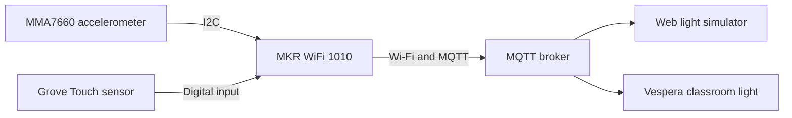

# Light Sand — Project Documentation

## Project Overview

Light Sand is a physical controller that uses the action of an hourglass to control a networked light display. Turning it over reverses the flow of light, shaking it creates a disturbance, and tapping a touch pad pauses or resumes an active transfer. At the end, the accumulated orange light breathes to indicate completion.

The controller uses an Arduino MKR WiFi 1010, an MMA7660 accelerometer and a Grove Touch v1.1 module. It sends RGB frames through Wi-Fi and MQTT. The light animation appears on the receiving display, while the handheld object provides the interaction.

The current prototype retains a breadboard and uses USB power. Its enclosure is made from cardboard and transparent sheet material. The development process is described in [Development Iterations](iterations.md).

## System Architecture



The Arduino reads the sensors, identifies the interaction, updates the timer and creates the light animation. It then publishes a complete RGB frame to the MQTT broker.

The development display has 72 cells arranged as 12 columns and 6 rows. Each LED receives three colour values, giving a total of 216 bytes per frame. The web grid numbering follows:

```text
LED index = column × 6 + row
```

The development MQTT topic is:

```text
student/CASA0014/luminaire/29
```

The web simulator established a way to check the animation during development. The physical positions of the LEDs on Vespera still need to be checked against the web grid. Broker receipt and the receiver's response also need to be distinguished from the Arduino simply reporting that it published a message.

## Hardware and Connections

The main components are:

- Arduino MKR WiFi 1010.
- Grove MMA7660 three-axis digital accelerometer.
- Grove Touch v1.1 sensor.
- Breadboard, jumper wires and Grove cables.
- USB data and power cable.
- Cardboard and transparent sheet enclosure.

| Module | Connection | MKR WiFi 1010 |
|---|---|---|
| MMA7660 | VCC | 3.3 V / VCC |
| MMA7660 | GND | GND |
| MMA7660 | SDA | D11 / SDA |
| MMA7660 | SCL | D12 / SCL |
| Touch | VCC | 3.3 V / VCC |
| Touch | GND | GND |
| Touch | SIG | D2 |
| Touch | NC | Unconnected |

Both modules share the 3.3 V supply and ground through the breadboard. The MMA7660 uses I²C at address `0x4C`; the touch module uses a separate digital input.

The accelerometer has a measurement range of approximately ±1.5 g. Strong movement can reach this limit, so the project uses shaking to produce a visual disturbance rather than reconstruct exact physical motion.

Further details are provided in the [bill of materials](hardware/BOM.md) and [wiring guide](hardware/wiring.md).

## Software Setup

1. Install Arduino IDE and the **Arduino SAMD Boards** package.
2. Select **Arduino MKR WiFi 1010** and the board's USB serial port.
3. Install **WiFiNINA**, **PubSubClient** and Seeed Studio's **Accelerometer_MMA7660** library.
4. Open `firmware/diagnostics/Two_Sensors_Test/Two_Sensors_Test.ino` and upload it.
5. Open the Serial Monitor at **115200 baud**. Check that X, Y and Z change when the sensor is moved and that touching the pad produces ON/OFF events.
6. Open `firmware/current/SandClock_WideFlow/SandClock_WideFlow.ino` as a separate sketch.
7. Copy `arduino_secrets.example.h` to `arduino_secrets.h` in the same sketch folder. Enter the local Wi-Fi and MQTT credentials. Keep this configured file out of the public repository.
8. Connect to a compatible **2.4 GHz Wi-Fi** network and check that the configured MQTT topic matches the intended receiver.
9. Upload the main sketch and open the Serial Monitor at **115200 baud**. Wait for the Wi-Fi and MQTT connection messages.
10. Select the matching channel in the web simulator and hold one orientation steady to begin the transfer.

The development firmware compiled for the MKR WiFi 1010. Exact library and board-package versions were not recorded for that build.

## Using the Hourglass

### Flip

Hold the opposite face steady for approximately 450 ms to reverse the flow. A flip preserves the amount of sand already transferred, so reversing partway through changes how long it takes for the new upper end to empty.

### Shake

Shake the object from side to side to disturb the moving light. This effect does not reset the timer or change its countdown rate. Very small movements should not create a large disturbance.

### Touch

Tap once during an active transfer to pause both the animation frame and the timer. Remove the finger, then tap again to resume. Holding the pad produces only one toggle. Releasing it prepares the input for the next tap.

Resuming continues in the existing direction immediately. A new flip is confirmed separately. Touch does not toggle pause while the program is waiting for an initial orientation or showing the completion effect.

### Completion

A full transfer takes 30 seconds of active time. Once complete, the settled orange light breathes smoothly. Flip the object to begin the transfer in the opposite direction.

### Serial Controls

| Input | Action |
|---|---|
| `r` | Restart |
| `+` / `-` | Adjust brightness |
| `a` | Select automatic shake-axis detection |
| `x` / `y` | Select a manual shake axis |

## Animation and Timing

The falling particles use rainbow colours, and settled particles become orange. Falling colour values are capped at 155, while the red channel of settled orange reaches 255 at the default master brightness. These are digital colour values rather than calibrated measurements of light intensity.

The animation represents 30 simulated grains, with a flight window of approximately 12 grains. Several grains can share a display cell, so the visible number of lit cells does not necessarily equal the number of simulated grains.

The program has four main states:

| State | Behaviour |
|---|---|
| WAIT | Waits for a recognised orientation; displays two dim cyan cells |
| FLOWING | Transfers sand in the confirmed direction |
| PAUSED | Holds the frame and remaining time |
| DONE_BREATHING | Varies the brightness of the settled orange light smoothly |

Pausing stops the progress of the transfer. Network reconnection also currently blocks normal operation and pauses progress, so the prototype depends on its network connection for normal display updates.

## Troubleshooting

| Problem | Checks |
|---|---|
| The USB port does not appear | Disconnect power, remove external wiring and test the bare board with a known USB data cable. Reconnect the modules in stages. |
| The accelerometer returns zero or is not detected | Check power, ground, SDA on D11 and SCL on D12. D1 and D2 are different pins. |
| The compiler reports redefined functions or variables | Keep separate complete sketches in separate folders. |
| `arduino_secrets.h` is missing | Create the local configuration file beside the main `.ino` file. |
| The web display does not change | Check Wi-Fi, MQTT connection messages and the selected topic/channel. |
| A flip triggers the shaking effect | Check sensor mounting and compare orientation changes with deliberate side-to-side movement in the serial readings. |
| Touch does not respond consistently | Run the separate sensor test and check SIG, shared ground and the pad's accessibility. |

## Evaluation and Limitations

| Function | Development observation | Current status |
|---|---|---|
| Three-axis acceleration | Static and moving values were received | Demonstrated |
| Touch with acceleration readings | ON/OFF events appeared while acceleration continued updating | Demonstrated |
| MQTT to web display | LED 0 and subsequent animation patterns appeared | Demonstrated |
| Pausing the countdown | Earlier logs held the remaining time at 9.8 and 4.0 seconds | Demonstrated in the hold-to-freeze version |
| Resuming while tilted | An earlier version remained in WAIT_POSE; the logic was revised | Latest combined hardware check outstanding |
| One toggle per tap | Press-event software testing and compilation completed | Final enclosure test outstanding |
| Distinguishing flip from shake | Sensitivity improved during iteration, but false disturbances were also reported | Further reliability testing needed |
| Automatic breathing at completion | Implemented in the compiled program | Final recorded display test outstanding |
| Enclosure fit | Assembly photographs show the construction process | Final fit and access checks outstanding |
| Physical Vespera mapping | Web numbering established | Physical mapping check outstanding |

The next combined test needs to cover repeated flips, small hand movements, deliberate shaking, pausing for several seconds, resuming and a complete uninterrupted transfer. It also needs to check that a sustained touch causes only one toggle and that the USB cable and sensor connections remain secure inside the shell.

The main limitations are the accelerometer's small measurement range, the low display resolution and blocking network reconnection. Sensor mounting and the way the controller is held also influence gesture recognition.

## Enclosure and Power

The MKR WiFi 1010 remains fixed to an 82 × 55 mm breadboard. The shell must accommodate the connected assembly, including the height of jumper connectors, Grove plugs and wire loops.

The construction explored a sloped support and two side panels closing over an existing base. A downward-facing USB connection interfered with standing the object on its end, so a side exit was considered by rotating the complete breadboard assembly while keeping the separately mounted accelerometer fixed relative to the shell.

The current build uses USB power because the available battery connectors did not fit the board. Final measurements, panel closure, grip comfort, touch access and cable clearance remain part of the physical evaluation. Construction details are collected in the [enclosure documentation](enclosure/README.md).

## What I Learned and Next Steps

The development showed me that adding more effects does not automatically make an interaction better. A stricter movement threshold could reduce false triggers but also make the controller feel unresponsive. I needed to consider flipping and shaking together rather than tuning each one in isolation.

Testing the sensors separately helped me distinguish a wiring problem from a problem in the animation or network connection. The touch interaction also showed how a small change in the intended action—from holding to tapping—required a corresponding change in the program's state logic.

Building the shell made the physical constraints clearer. The enclosure had to fit the real cables and connectors, and the sensor needed to stay secure while the object moved. The remaining work is to complete the combined tests, record the final enclosure dimensions, verify the actual classroom light mapping and investigate nonblocking networking if reconnection delays continue to affect the interaction.

## References and Acknowledgements

- [Arduino MKR WiFi 1010 documentation](https://docs.arduino.cc/hardware/mkr-wifi-1010/)
- [Official MKR WiFi 1010 pinout](https://docs.arduino.cc/resources/pinouts/ABX00023-full-pinout.pdf)
- [Seeed Grove MMA7660 documentation](https://wiki.seeedstudio.com/Grove-3-Axis_Digital_Accelerometer-1.5g/)
- [Seeed MMA7660 library](https://github.com/Seeed-Studio/Accelerometer_MMA7660)
- [Seeed Grove Touch documentation](https://wiki.seeedstudio.com/Grove-Touch_Sensor/)
- [GitHub file-upload guidance](https://docs.github.com/en/repositories/working-with-files/managing-files/adding-a-file-to-a-repository)
- [AI assistance disclosure](AI_USAGE.md)
