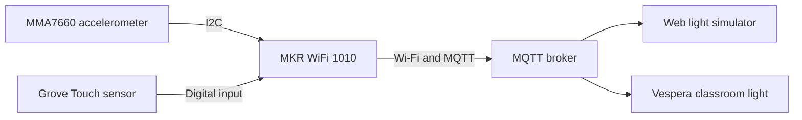

# Light Sand — Project Documentation

## Project Overview

Light Sand is a physical controller that uses the action of an hourglass to control a networked light display. Turning it over reverses the flow of light, shaking it creates a disturbance, and tapping a touch pad pauses or resumes an active transfer. At the end, the accumulated orange light breathes to indicate completion.

The controller uses an Arduino MKR WiFi 1010, an MMA7660 accelerometer and a Grove Touch v1.1 module. It sends RGB frames through Wi-Fi and MQTT. The light animation appears on the receiving display, while the handheld object provides the interaction.

The current prototype retains a breadboard and uses USB power. Its enclosure is made from cardboard and transparent sheet material. The development process is described in [Development Iterations](Development%20Iterations.docx).

## System Architecture



The Arduino reads the sensors, identifies the interaction, updates the timer and creates the light animation. It then publishes a complete RGB frame to the MQTT broker.

The development display has 72 cells arranged as 12 columns and 6 rows. Each LED receives three colour values, giving a total of 216 bytes per frame. The web grid numbering follows:

```text
LED index = column × 6 + row
```

The development MQTT topic is:

```text
student/CASA0014/luminaire/29
```

The web simulator established a way to check the animation during development. The physical positions of the LEDs on Vespera still need to be checked against the web grid. Broker receipt and the receiver's response also need to be distinguished from the Arduino simply reporting that it published a message.

## Hardware and Connections

The main components are:

- Arduino MKR WiFi 1010.
- Grove MMA7660 three-axis digital accelerometer.
- Grove Touch v1.1 sensor.
- Breadboard, jumper wires and Grove cables.
- USB data and power cable.
- Cardboard and transparent sheet enclosure.

| Module | Connection | MKR WiFi 1010 |
|---|---|---|
| MMA7660 | VCC | 3.3 V / VCC |
| MMA7660 | GND | GND |
| MMA7660 | SDA | D11 / SDA |
| MMA7660 | SCL | D12 / SCL |
| Touch | VCC | 3.3 V / VCC |
| Touch | GND | GND |
| Touch | SIG | D2 |
| Touch | NC | Unconnected |

Both modules share the 3.3 V supply and ground through the breadboard. The MMA7660 uses I²C at address `0x4C`; the touch module uses a separate digital input.

The accelerometer has a measurement range of approximately ±1.5 g. Strong movement can reach this limit, so the project uses shaking to produce a visual disturbance rather than reconstruct exact physical motion.

Further details are provided in the [bill of materials](hardware/BOM.md) and [wiring guide](hardware/wiring.md).

## Software Setup

1. Install Arduino IDE and the **Arduino SAMD Boards** package.
2. Select **Arduino MKR WiFi 1010** and the board's USB serial port.
3. Install **WiFiNINA**, **PubSubClient** and Seeed Studio's **Accelerometer_MMA7660** library.
4. For an independent accelerometer check, open `sand_clock/MMA7660FC_Demo/MMA7660FC_Demo.ino` and upload it.
5. Use the baud rate specified by that diagnostic sketch and check that X, Y and Z change when the sensor is moved. The main sketch below provides the combined interaction.
6. Open `SandClock_WideFlow/SandClock_WideFlow.ino` as a separate sketch.
7. Create or configure `arduino_secrets.h` beside the main `.ino`, using the credential macro names referenced by that sketch. Enter the local Wi-Fi and MQTT credentials and keep the configured values private.
8. Connect to a compatible **2.4 GHz Wi-Fi** network and check that the configured MQTT topic matches the intended receiver.
9. Upload the main sketch and open the Serial Monitor at **115200 baud**. Wait for the Wi-Fi and MQTT connection messages.
10. Select the matching channel in the web simulator and hold one orientation steady to begin the transfer.

The development firmware compiled for the MKR WiFi 1010. Exact library and board-package versions were not recorded for that build.

## Using the Hourglass

### Flip

Hold the opposite face steady for approximately 450 ms to reverse the flow. A flip preserves the amount of sand already transferred, so reversing partway through changes how long it takes for the new upper end to empty.

### Shake

Shake the object from side to side to disturb the moving light. This effect does not reset the timer or change its countdown rate. Very small movements should not create a large disturbance.

### Touch

Tap once during an active transfer to pause both the animation frame and the timer. Remove the finger, then tap again to resume. Holding the pad produces only one toggle. Releasing it prepares the input for the next tap.

Resuming continues in the existing direction immediately. A new flip is confirmed separately. Touch does not toggle pause while the program is waiting for an initial orientation or showing the completion effect.

### Completion

A full transfer takes 30 seconds of active time. Once complete, the settled orange light breathes smoothly. Flip the object to begin the transfer in the opposite direction.

### Serial Controls

| Input | Action |
|---|---|
| `r` | Restart |
| `+` / `-` | Adjust brightness |
| `a` | Select automatic shake-axis detection |
| `x` / `y` | Select a manual shake axis |

## Animation and Timing

The falling particles use rainbow colours, and settled particles become orange. Falling colour values are capped at 155, while the red channel of settled orange reaches 255 at the default master brightness. These are digital colour values rather than calibrated measurements of light intensity.

The animation represents 30 simulated grains, with a flight window of approximately 12 grains. Several grains can share a display cell, so the visible number of lit cells does not necessarily equal the number of simulated grains.

The program has four main states:

| State | Behaviour |
|---|---|
| WAIT | Waits for a recognised orientation; displays two dim cyan cells |
| FLOWING | Transfers sand in the confirmed direction |
| PAUSED | Holds the frame and remaining time |
| DONE_BREATHING | Varies the brightness of the settled orange light smoothly |

Pausing stops the progress of the transfer. Network reconnection also currently blocks normal operation and pauses progress, so the prototype depends on its network connection for normal display updates.

## Troubleshooting

| Problem | Checks |
|---|---|
| The USB port does not appear | Disconnect power, remove external wiring and test the bare board with a known USB data cable. Reconnect the modules in stages. |
| The accelerometer returns zero or is not detected | Check power, ground, SDA on D11 and SCL on D12. D1 and D2 are different pins. |
| The compiler reports redefined functions or variables | Keep separate complete sketches in separate folders. |
| `arduino_secrets.h` is missing | Create the local configuration file beside the main `.ino` file. |
| The web display does not change | Check Wi-Fi, MQTT connection messages and the selected topic/channel. |
| A flip triggers the shaking effect | Check sensor mounting and compare orientation changes with deliberate side-to-side movement in the serial readings. |
| Touch does not respond consistently | Run the separate sensor test and check SIG, shared ground and the pad's accessibility. |

## Evaluation and Limitations

The owner's latest acceptance record contains eight passed checks and one area needing improvement. Deliberate horizontal shaking was confirmed as PASS on 4 November 2026.

| Test action | Expected result | Recorded result |
|---|---|---|
| Start face-up | Flow begins | PASS |
| Start face-down | Opposite flow begins | PASS |
| Flip 10 times with pauses | Correct direction with minimal false shake | PASS |
| Light hand jitter | No disruptive shake animation | NEEDS IMPROVEMENT |
| Deliberate horizontal shaking | Visible disturbance without resetting the timer | PASS |
| Tap, wait 5 seconds, then tap again | Frame and countdown freeze, then resume | PASS |
| Hold touch for 3 seconds | One toggle only | PASS |
| Full uninterrupted transfer | Approximately 30 seconds, then breathing | PASS |
| USB cable through the enclosure opening | No cable strain or loose connectors | PASS |

Light hand jitter remains the main interaction issue. Passing deliberate shaking does not mean all small unintended movements are rejected. The accelerometer's limited range, the display's low resolution and blocking network reconnection also remain practical limitations.

The acceptance sheet records qualitative results. A measured timing error, false-trigger rate and final demonstration recording have not yet been included.

## Enclosure and Power

The enclosure uses cardboard and transparent sheet material. The MKR WiFi 1010 remains mounted on an 82 × 55 mm breadboard. The owner confirmed the following dimensions on 4 November 2026:

| Part | Confirmed size |
|---|---|
| Overall enclosure height | 24.5 cm (245 mm) |
| Reported overall enclosure width | 8.5 cm (85 mm) |
| Central rectangle on the front face | 6 cm wide × 5 cm high (60 × 50 mm) |
| Central rectangle on the back face | 6 cm wide × 5 cm high (60 × 50 mm) |
| Breadboard footprint | 8.2 × 5.5 cm (82 × 55 mm) |

Both front and back central rectangles retained the 6 × 5 cm design. The final depth, complete remaining panel outlines and measured USB/touch openings still need to be recorded before the model can be reproduced from a full cutting plan.

The prototype uses USB power. Its fitted USB cable arrangement was marked PASS in the acceptance sheet. The construction explored a sloped board support and two side panels closing over the existing base. Further construction details are in the [enclosure documentation](enclosure/README.md).

## What I Learned and Next Steps

The development showed me that more effects do not automatically make the interaction better. I had to balance responsiveness with accidental triggering and consider flipping and shaking together. The latest results mark both deliberate actions as passed, while small hand movements still need better filtering.

Separate sensor tests helped me distinguish wiring problems from animation or network problems. Changing touch from holding to tapping also showed how the intended physical action needed to match the program's state logic.

Building the shell made the real constraints clearer: the connected components, cable bends and USB plug had to fit inside it. The overall height, width and central rectangles are now recorded, so they are no longer missing measurements.

## Remaining Verification and Documentation

- **[TO IMPROVE] Light hand jitter:** small unintended movements still need better rejection. Record these movements, adjust the motion filter if necessary and retest deliberate shaking and flipping together.
- **[TO COMPLETE] Final panel plan:** overall height, overall width and both central rectangles are recorded. Overall depth, the remaining panel dimensions and measured USB/touch opening sizes still need to be added to complete the cutting plan.
- **[TO VERIFY] Physical Vespera mapping:** confirm which physical LED positions correspond to the web-grid numbering and record the actual classroom-light response.
- **[TO ADD] Final demonstration and measured limitations:** add a short real-device video and record timing deviation and remaining gesture-detection limitations. The current acceptance sheet contains pass/fail results rather than these quantitative measurements.

## Future Improvement

Nonblocking Wi-Fi/MQTT reconnection is a future software improvement. The current program can pause normal interaction during reconnection. This change has not been implemented, and it is separate from the completed interaction tests.

## References and Acknowledgements

- [Arduino MKR WiFi 1010 documentation](https://docs.arduino.cc/hardware/mkr-wifi-1010/)
- [Official MKR WiFi 1010 pinout](https://docs.arduino.cc/resources/pinouts/ABX00023-full-pinout.pdf)
- [Seeed Grove MMA7660 documentation](https://wiki.seeedstudio.com/Grove-3-Axis_Digital_Accelerometer-1.5g/)
- [Seeed MMA7660 library](https://github.com/Seeed-Studio/Accelerometer_MMA7660)
- [Seeed Grove Touch documentation](https://wiki.seeedstudio.com/Grove-Touch_Sensor/)
- [GitHub file-upload guidance](https://docs.github.com/en/repositories/working-with-files/managing-files/adding-a-file-to-a-repository)
- [AI assistance disclosure](AI_USAGE%2004.47.35.md)
