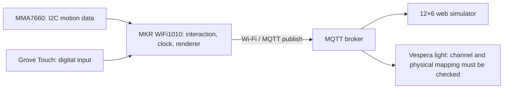

# System architecture

The main sketch creates a216-byte RGB frame for72LEDs and publishes on the configured luminaire topic. The web grid indexes cells as `column*6+row`. Wi-Fi credentials and MQTT credentials are separate local configuration values.

The physical controller does not contain a sand display. The receiver visualises its output. A successful publish call alone does not prove broker receipt; include actual receive evidence. Reconnection currently blocks normal operation and pauses progress.
